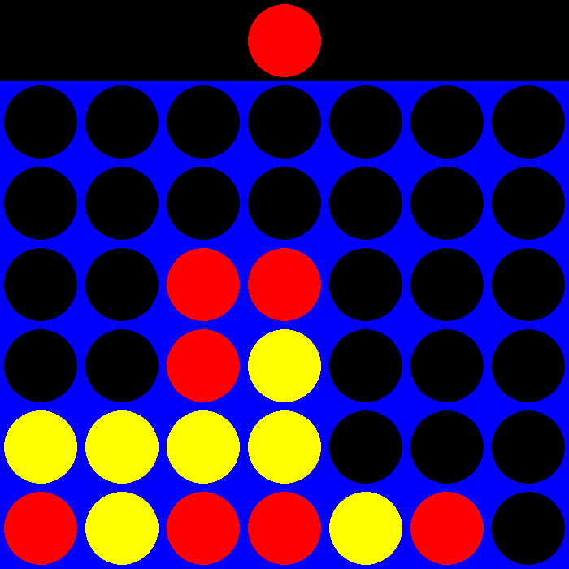

# Connect 4 with AI

The classic Connect 4 game made with **Python and Pygame**, with a computer opponent that plans its moves using the **minimax algorithm with alpha-beta pruning**.



## Features
- **Two game modes:** Player vs Player on the same computer, or Player vs AI.
- **Smart AI opponent:** looks 5 moves ahead to choose the best column.
- **Mouse controls:** the next piece follows your mouse, and you click a column to drop it.
- **Win detection:** horizontal, vertical, and both diagonal directions.
- **Replay menu:** play again or exit after each game.

## How to run
```bash
pip install -r requirements.txt
python connect4_ai.py
```
Pick a mode from the menu, then click a column to drop your piece. Red plays first in Player vs Player. In Player vs AI, a random player starts.

## How the AI works
1. **Minimax:** the AI imagines every possible sequence of moves up to 5 turns ahead (its moves and yours). It assumes you will always play your best move, and picks the column that leaves it in the best position.
2. **Alpha-beta pruning:** while searching, it skips branches that can't change the final decision. This gives the same answer as plain minimax but much faster (about 0.1 seconds per move).
3. **Scoring a board** (`score_position`): when the search stops, the AI scores the board by checking every window of 4 cells:
   - 4 of its pieces → huge score (a win)
   - 3 of its pieces + 1 empty → good
   - 2 of its pieces + 2 empty → slightly good
   - 3 of the opponent's pieces + 1 empty → bad (the opponent is about to win)
   - pieces in the center column get a bonus, because the center is part of the most possible lines.

## Code structure
| Function | What it does |
|----------|--------------|
| `create_board`, `drop_piece`, `get_next_open_row` | Board stored as a 6×7 NumPy array |
| `winning_move` | Checks all four directions for four in a row |
| `evaluate_window`, `score_position` | Score a board for the AI |
| `minimax` | Recursive search with alpha-beta pruning |
| `draw_board` | Draws the board and pieces with Pygame |
| `main_menu`, `player_vs_player`, `player_vs_ai`, `replay_menu` | Menus and game loops |

## Built with
Python, Pygame, NumPy
